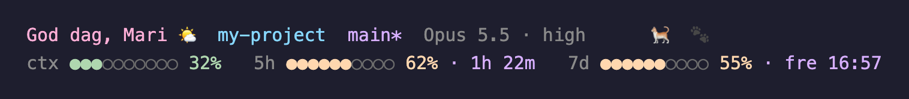
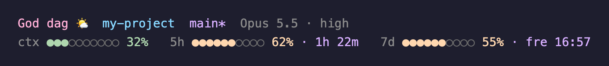

# claude-statusline 🐈

A cozy two-line status line for [Claude Code](https://code.claude.com), by Mari Svennevik Notland 🌸. Line 1 has a greeting that follows the clock, the project, the git branch, model + effort, and Sussi, the cat my design system is named after, trotting across the line while Claude works. Line 2 has meters for the context window, the 5-hour limit and the weekly limit.



```
God dag, Mari 🌤️  my-project  main*  Opus 5.5 · high  🐈  🐾
ctx ●●●○○○○○○○ 32%   5h ●●●●●●○○○○ 62% · 1h 23m   7d ●●●●●●○○○○ 55% · fre 16:57
```

## Install

1. Copy `statusline.sh` to `~/.claude/statusline.sh` and make it executable (`chmod +x`).
2. Add this to `~/.claude/settings.json`:

```json
{
  "statusLine": {
    "type": "command",
    "command": "~/.claude/statusline.sh"
  }
}
```

Requires `jq`. Both lines fit in an 80-column pane.

For a smooth-running cat and a live countdown, add `"refreshInterval": 1` to the `statusLine` block.

## Make it yours

The greeting is in Norwegian and uses my name, and Sussi is my signature. Two environment variables change that, so you don't have to edit the script:

| Variable | What it does |
|---|---|
| `STATUSLINE_NAME=Ola` | your name in the greeting. Empty (`STATUSLINE_NAME=`) means no name |
| `STATUSLINE_PERSONAL=0` | turns off my signature: no name unless you set one, and no cat |

Put them in front of the command, for example `"command": "STATUSLINE_PERSONAL=0 ~/.claude/statusline.sh"`. `statusline.sh --help` lists them, and `--version` prints the version.



## What it shows

| Part | Source |
|---|---|
| Greeting | local time: morning, day, evening, night |
| Project | basename of the current directory |
| Branch | current git branch, `*` when there are uncommitted changes |
| Model · effort | `.model.display_name` and `.effort.level` — effort turns peach when it is below `high` |
| 🐈 Sussi | moves one step per second, so she runs while the line redraws. From 23 to 06 she sleeps (`🐈💤`) |
| ctx | `.context_window.used_percentage` |
| 5h · time left | `.rate_limits.five_hour` — used % and time until `resets_at` |
| 7d · reset day | `.rate_limits.seven_day` — used % and the day and time it resets |

Meters are soft pastel dots: mint under 50 %, peach from 50 % and coral from 80 % (kept clear of the pink greeting). Day names are Norwegian (`man tir ons tor fre lør søn`). The rate-limit meters only appear on plans that report limits. Works on macOS and Linux (`date -r` with a GNU `date -d` fallback).

It also writes a small usage snapshot to `~/Library/Caches/claude-usage/snapshot.json` for a separate desktop widget. Remove the four lines under "Persist a usage snapshot" if you don't need it. Nothing is sent anywhere: the script makes no network calls.

The screenshots use demo data.

Made by Mari Svennevik Notland · MIT License
